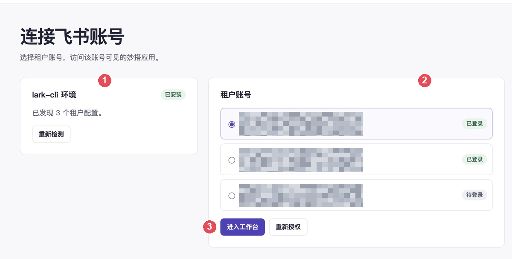
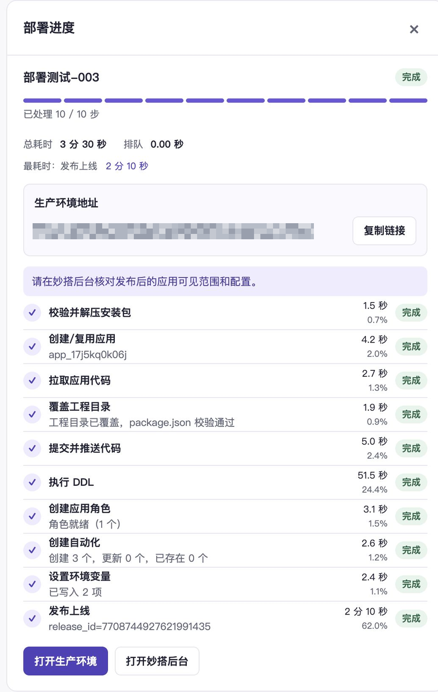
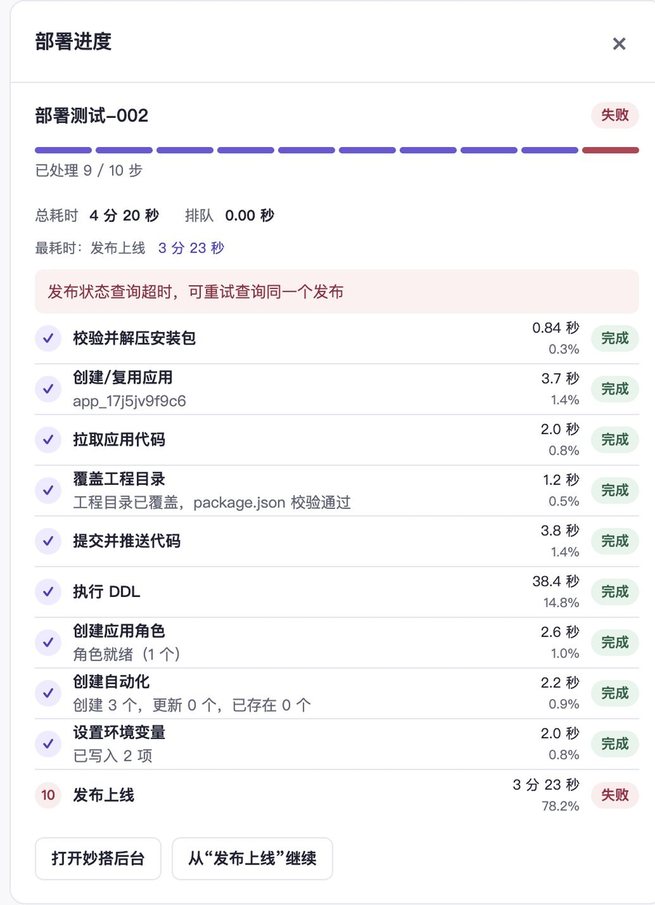

# 妙搭应用打包和部署方案

## 第一章 方案介绍

本机打包妙搭应用、跨租户部署或覆盖已有应用。打包和覆盖面向全栈应用，新建部署也支持前端／创意应用安装包。

**安全：本机运行、文件与记录本地保存，无平台云端中转；部署源码和配置直接提交目标妙搭租户。**

获取项目：[GitHub · jinda27/miaoda-devops](https://github.com/jinda27/miaoda-devops)，点击 **Code → Download ZIP** 下载并解压。

## 第二章 功能演示

| 步骤 | 怎么做 | 对应截图 |
| --- | --- | --- |
| 1. 启动平台 | 安装 Node.js 20.19+、Go 1.22+、Git 和 lark-cli；全栈打包需 `miaoda-app-assemble` 及其依赖。 项目根目录：macOS／Linux 运行 `./scripts/start.sh`，Windows 运行 `scripts\start.bat`。 打开 `http://127.0.0.1:18080/`。 | 终端启动 |
| 2. 连接账号 | 选择租户 → **登录所选账号**并授权 → **进入工作台**。 无配置时先运行 `lark-cli config init --name my-tenant`，再点**重新检测**。 |  |
| 3. 打包应用 | **应用打包** → 输入应用名称 → 核对应用 ID → 点击**打包**。 |  |
| 4. 下载 ZIP | 等待“完成” → 点击**下载安装包**。 包含源码、数据库结构及配置；业务数据另行迁移。 |  |
| 5A. 新建部署 | 切换目标租户 → **应用部署** → 填写名称 → 导入 ZIP（≤256 MB）→ **确认部署**。 |  |
| 5B. 覆盖部署 与 5A 二选一 | 搜索并选择目标应用 → 导入全栈 ZIP → **检查目标应用** → 输入目标 ID → **确认覆盖并部署**。 **会清理表数据、角色、变量并停用旧自动化，请先备份。** |  |
| 6. 访问应用 | 等待部署“完成” → **打开生产环境**或**复制链接**。 后台核对可见范围；“需检查”按提示处理。 |  |
| 7. 失败续跑 按需操作 | 选择失败的部署记录 → 修复提示问题 → **从“失败步骤”继续**，复用已有目标应用。 |  |
